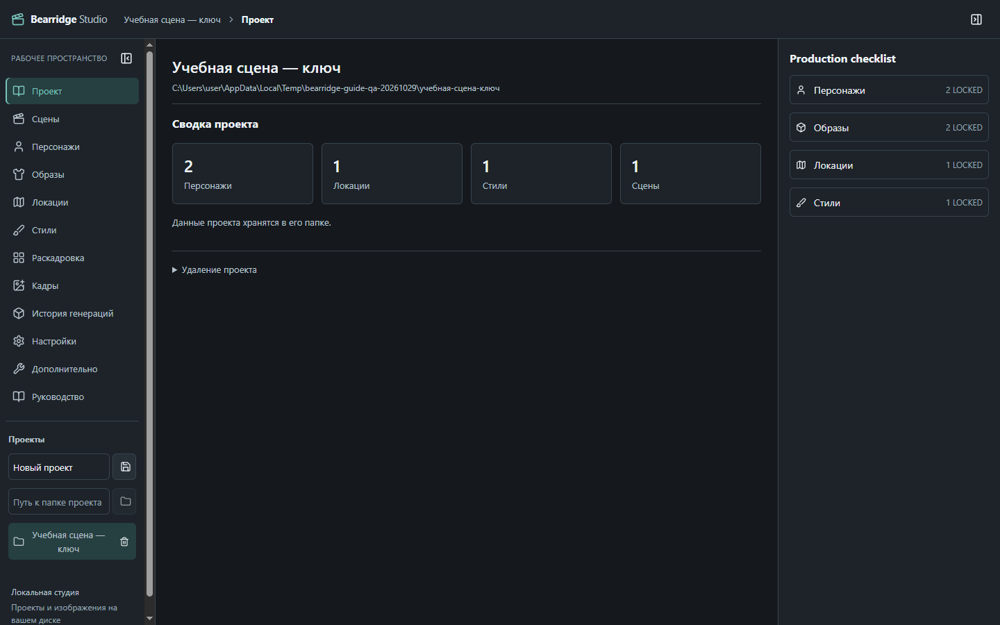
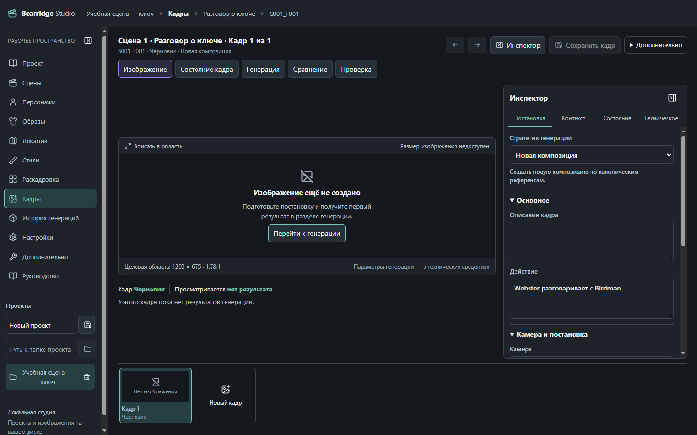
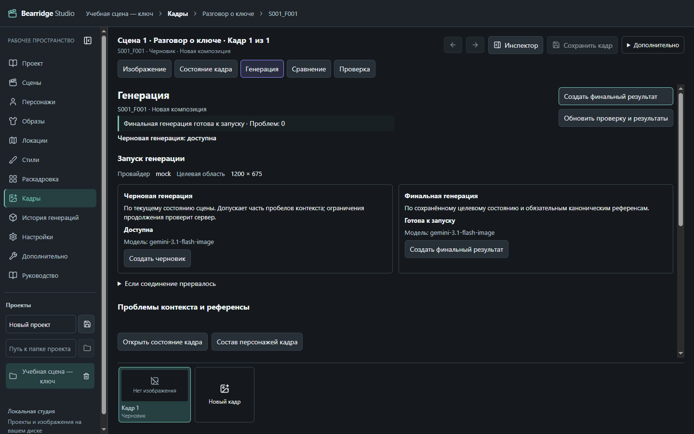

# Руководство пользователя

Bearridge помогает создавать последовательные изображения для визуальной новеллы: подготовить персонажей и места, поставить сцену, получить варианты кадров и выбрать подходящие. Работайте небольшими шагами — сначала одна комната, два персонажа и три кадра.

Встроенное оглавление слева ведёт к нужной теме. Кнопка **К работе** возвращает к открытому рабочему экрану. Открытие руководства сохраняет несохранённый текст в текущей сессии, но не записывает его на диск. Перед закрытием программы сохраняйте изменения обычными кнопками.

## 1. Как устроена работа

**Проект → Персонажи и окружение → Сцена → Кадры → Генерация → Проверка результата.**

Проект — вся история с её изображениями и настройками. Сцена — эпизод, например разговор в комнате. Кадр — одно изображение этого эпизода: общий план комнаты, крупный план говорящего, передача ключа.

Bearridge пока не собирает готовые страницы новеллы с панелями и текстом. Здесь вы подготавливаете отдельные кадры. Персонажи, одежда, окружение и стиль помогают сохранять узнаваемость между ними, но каждый результат всё равно нужно проверить.

## 2. Создаём первый проект

1. В левой панели найдите блок **Проекты**.
2. В поле **Название нового проекта** введите, например, «Ключ от комнаты».
3. Нажмите кнопку с подсказкой **Создать проект** рядом с полем.
4. Откроется раздел **Проект**. Слева доступны **Персонажи**, **Образы**, **Локации**, **Стили**, **Сцены** и другие разделы.

Уже созданный проект можно выбрать по имени слева. Если его нет в списке, укажите путь к его папке в поле **Путь к папке проекта** и нажмите **Открыть проект**. При следующем запуске может появиться кнопка **Продолжить последний проект**.

Проект хранится в папке на вашем компьютере. Для резервной копии закройте приложение и скопируйте всю папку проекта, а не только отдельные картинки. Удаление проекта из списка слева оставляет его файлы на диске. Отдельная опасная операция удаления папки требует дополнительного подтверждения — не используйте её для обычного переключения проектов.

Если панель меню свёрнута, наведите указатель на значок, чтобы увидеть название, или нажмите **Развернуть навигацию**. Пункт **Руководство** доступен даже до открытия проекта.

## 3. Подготавливаем персонажей и одежду

1. Откройте **Персонажи**.
2. Заполните **Имя** нового персонажа и нажмите **Новый персонаж**. Для примера создайте Birdman и Webster.
3. Выберите персонажа в списке. Опишите его постоянные черты: телосложение, лицо, волосы и отличительные детали. Нажмите **Сохранить** после изменений.
4. В блоке референсов загрузите изображение в подходящий слот. Референс — образец, на который будет ориентироваться генератор. Для основного вида используется слот **MASTER**.
5. Проверьте загруженный образец, нажмите **Одобрить**, затем **Закрепить**. Загрузка сама по себе не делает картинку основным образцом.
6. В блоке **Образы** нажмите **Новый образ**. Задайте название и **Описание одежды**, при необходимости заполните **Неизменяемые элементы**, затем нажмите **Сохранить образ**.
7. Загрузите и закрепите основной референс одежды. Повторите подготовку для второго персонажа.

Раздел **Образы** в меню тоже позволяет работать с одеждой выбранного персонажа. Сама одежда принадлежит персонажу; какой образ он носит в эпизоде, вы указываете в состоянии истории.

> **Совет:** выбирайте чёткие образцы с хорошо видимыми важными чертами. Новая версия референса не переписывает прошлые изображения. Не закрепляйте случайный или ещё не проверенный вариант.

Если образцов пока нет, можно описывать персонажей и планировать кадры. Финальная генерация потребует обязательные закреплённые образцы; черновик доступен только при выполнении условий, показанных на экране генерации. Bearridge не создаёт канонический образец автоматически за вас.

## 4. Добавляем локацию, ракурсы и стиль

1. Откройте **Локации**, задайте название, например «Комната», и нажмите **Новая локация**.
2. Выберите её в списке. Опишите помещение, архитектуру и важные постоянные детали. Сохраните изменения.
3. Загрузите образец помещения, одобрите и закрепите его. Не используйте один и тот же слот как склад несвязанных комнат.
4. Если нужны разные точки съёмки, в блоке **Ракурсы** нажмите **Новый ракурс**. Заполните **Название ракурса** и **Описание камеры**, сохраните и добавьте подходящий референс. Ракурс можно выбрать в контексте кадра.
5. Откройте **Стили**, укажите название и нажмите **Новый стиль**. Опишите характер линий, цвет, свет и нужную степень детализации. Сохраните, затем загрузите и закрепите референсы стиля.

Один стиль на короткую сцену помогает избежать скачков от плоского рисунка к реалистичному. Образец стиля объясняет, как рисовать; он не должен заменять образец персонажа или комнаты.

## 5. Создаём сцену

1. Откройте **Сцены** и нажмите **Новая сцена**.
2. Задайте название, например «Разговор о ключе». При необходимости укажите время, локацию, стиль и персонажей сцены.
3. Создайте сцену. Для последующих изменений откройте её кнопкой **Редактор**.
4. В **Описание сцены** напишите: «Birdman и Webster разговаривают в комнате. У Webster есть ключ». Сохраните изменения кнопкой **Сохранить**.
5. Раскройте **Текущее состояние сцены**, чтобы задать начальные условия: время, присутствие персонажей, их образы и другие важные детали. У этого блока своя кнопка сохранения с подсказкой **Сохранить состояние сцены**.

Персонажи сцены — участники эпизода в целом. Они не обязаны все появляться на каждом изображении. Состав конкретного кадра задаётся отдельно.

## 6. Создаём первый кадр

1. У сцены нажмите **Раскадровка** или **Открыть раскадровку**. Затем нажмите **Новый кадр**.
2. Откройте карточку кадра. Вверху находятся вкладки **Изображение**, **Состояние кадра**, **Генерация**, **Сравнение**, **Проверка**. Справа — **Инспектор**, который можно свернуть.
3. В **Постановка** заполните **Действие**, например: «Webster разговаривает с Birdman». В **Камера** напишите «общий план», в **Композиция** — как расположены герои.
4. В **Контекст** проверьте состав персонажей кадра, локацию, при необходимости ракурс и стиль. Если в кадре виден только Webster, не оставляйте Birdman в составе просто потому, что он участвует в сцене.
5. Нажмите **Сохранить кадр**. Изменения состояния истории сохраняются отдельно, как описано ниже.

Не обязательно сразу заполнять все творческие поля. Начните с понятного действия, персонажей и камеры. Но отсутствие обязательного контекста или референсов может блокировать финальную генерацию.

Размер целевой области задаёт желаемую форму кадра, а не обещает точный размер картинки от генератора. Разные кадры могут иметь разную форму.

## 7. Состояние истории и предметы

Состояние истории помогает записать, кто участвует в происходящем, какую одежду носит и какие детали должны сохраняться дальше. Это ваша запись о событиях, а не автоматическое распознавание картинки.

**Текущее состояние сцены** задаёт исходные условия. Во вкладке **Состояние кадра** хранится отдельное целевое состояние конкретного кадра. Финальная генерация использует сохранённое состояние кадра. Изменение сцены позднее не заменяет автоматически уже созданные состояния кадров.

1. В кадре откройте **Состояние кадра** и нажмите **Редактировать**.
2. Проверьте время, присутствие персонажей и **Образ** каждого из них. Присутствие в этой записи и видимый состав кадра — разные настройки.
3. Для предмета нажмите **Добавить предмет**. У новой карточки будет служебное имя вроде `prop_1`. Пока отдельного удобного каталога предметов здесь нет; используйте одно и то же обозначение последовательно.
4. В **У персонажа** выберите имя. Это связь предмета с персонажем, а не команда вложить вещь ему в руку. **Расположение** и **Состояние** заполняйте только если они известны.
5. Отдельно в карточке персонажа найдите **Удерживаемые предметы**. Нажмите **Добавить** и запишите то, что он действительно держит, например «ключ». В редакторе состояния сцены аналогичное поле называется **В руках**.
6. Нажмите **Сохранить** в редакторе состояния. Сохранение постановки кадра не заменяет эту кнопку.

### Пример: ключ переходит от Webster к Birdman

- Первый кадр: предмет связан с Webster. Если он держит ключ, запишите «ключ» также в его удерживаемых предметах. Если известно только, что ключ у него, удержание не придумывайте.
- Второй кадр: в **Действие** явно напишите «Webster передаёт ключ Birdman». В целевом состоянии выберите Birdman у предмета, уберите ключ из удерживаемых предметов Webster и добавьте Birdman, если именно так должна закончиться передача.
- Третий кадр: Birdman продолжает держать ключ. Сохраните эти значения; не описывайте новую передачу, если её нет.
- Когда Birdman кладёт ключ на стол, явно опишите действие, уберите ключ из его удерживаемых предметов и укажите расположение «на столе». При необходимости выберите **Без владельца** — эта подпись означает отсутствие заданной связи с персонажем, а не решение о юридической собственности.

> **Важно:** смена значения **У персонажа** не обновляет списки в руках автоматически. Вещь может принадлежать одному человеку, а держать её может другой. Bearridge не должен угадывать это за вас.

Сравнение **Исходное → Целевое** помогает проверить записанные изменения. Если сохранена ссылка на удалённого или недоступного персонажа, появится неизвестный владелец с его прежним обозначением. Не меняйте его на случайное имя ради исчезновения предупреждения.

## 8. Генерируем изображение

1. Сохраните постановку и состояние кадра, затем откройте **Генерация**.
2. Посмотрите блоки готовности и **Проблемы контекста и референсы**. Исправьте блокирующие причины: например, выберите образ или закрепите отсутствующий референс.
3. При необходимости нажмите **Обновить проверку и результаты**.
4. Если настроен доступный провайдер и финальная генерация готова, нажмите **Создать финальный результат**. Для проб можно использовать **Создать черновик**, когда он доступен.
5. Дождитесь результата. В карточке изображения нажмите **Посмотреть**. Это открывает изображение, но ещё не выбирает его окончательно.

Черновая генерация использует текущее состояние сцены; финальная — сохранённое состояние кадра. Для проверки последовательности ориентируйтесь на финальный контекст. Результат черновика может не подходить для закрепления после изменений состояния.

Прямой запуск требует заранее настроенного провайдера и ключа на стороне приложения. Если это ещё не сделано, используйте доступный ручной путь через ChatGPT. Доступность его экспорта тоже зависит от готовности кадра.

Если провайдер обозначен **mock**, он создаёт только тестовую заглушку, а не настоящее изображение. Скриншоты этого руководства сняты на таком учебном проекте.

> Если связь прервалась после запуска, сначала обновите результаты и статус кадра. Не нажимайте запуск повторно вслепую: предыдущий запрос мог уже выполниться.

## 9. Генерация через ChatGPT: экспорт и импорт

Это ручной обмен файлами. Bearridge сам не отправляет материалы в ChatGPT и не получает ответ из вашей переписки.

1. Подготовьте и сохраните кадр. Откройте **Генерация**, устраните блокирующие причины.
2. В блоке **ChatGPT · ручной экспорт и импорт** нажмите **Экспорт для ChatGPT**. Сохраните скачанный ZIP-пакет и распакуйте его.
3. Прочитайте файл `00_README.txt`. В пакете есть `01_CHATGPT_PROMPT.txt`, `CHATGPT_INSTRUCTIONS.md`, изображения и файл описания пакета. Не переименовывайте материалы без необходимости.
4. Откройте новый разговор в ChatGPT с доступной генерацией изображений. Загрузите нужные изображения из пакета **отдельными вложениями**, затем скопируйте весь текст `01_CHATGPT_PROMPT.txt`. Не рассчитывайте, что загрузка одного ZIP автоматически передаст все инструкции.
5. Для новой композиции используйте приложенные образцы. Для продолжения особенно важно загрузить изображение с именем `AUTHORITATIVE_BASE`: это кадр, который нужно редактировать. Изображения `IDENTITY_REFERENCE` помогают сохранить внешность, а не заменяют основу.
6. Получите изображение и сохраните сам файл на компьютер. Текстовый ответ или ссылка на переписку не подходят для импорта.
7. Вернитесь к тому же кадру Bearridge. В **История экспорта** проверьте поле **Пакет для импорта**: выберите именно тот экспорт, по которому получали изображение. Если пакетов несколько, ориентируйтесь на время и тип операции.
8. Нажмите **Импорт результата ChatGPT** и выберите PNG, JPEG или WEBP. Импортируется изображение, а не исходный ZIP.
9. Дождитесь появления результата и проверьте его во вкладках **Сравнение** и **Проверка**. Импорт сам не закрепляет кадр.

При стратегии **Продолжить предыдущий кадр** в постановке появляется блок **Продолжение и изменения**. В поле **Явные изменения** укажите, что разрешено менять в ручном пакете продолжения. Опишите передачу или перемещение предмета явно; одно назначение владельца не заменяет инструкцию о физическом действии. Остальные части основы должны сохраняться.

> Не выбирайте случайный пакет, чтобы импортировать «похожую» картинку. Пакет сохраняет условия, по которым она была запрошена. Если вы существенно изменили кадр после экспорта, подготовьте новый экспорт; старый результат не обязательно соответствует новым условиям.

Если кнопка импорта недоступна, проверьте, выбран ли пакет экспорта. Если импорт отклонён, прочитайте сообщение: не подменяйте файл или пакет только ради обхода проверки.

## 10. Сравниваем, проверяем и закрепляем

1. Во вкладке **Сравнение** сопоставьте доступные варианты. Для сравнения A/B нужны хотя бы два результата текущего кадра. Просмотр другого изображения не меняет выбранный результат.
2. У подходящего варианта нажмите **Выбрать результат**. Убедитесь, что отметка выбора появилась именно у нужного изображения.
3. Откройте **Проверка**. Сверьте лица и силуэты, одежду, комнату, стиль, свет, предметы и само действие. При передаче ключа посмотрите, кто действительно его держит.
4. Если результат подходит и проверка готовности разрешает действие, нажмите **Закрепить кадр**. Прочитайте подтверждение и подтвердите выбор.

Закрепление означает, что вы окончательно выбираете изображение, которое станет частью истории и сможет служить основой для продолжения. Статус **LOCKED** означает «закреплён».

После закрепления постановка, состав и состояние кадра доступны только для просмотра; обычного свободного редактирования или кнопки «разблокировать» здесь нет. Не закрепляйте вариант «на время». Если выбранное изображение получено для другого состояния, приложение может запретить закрепление — подготовьте результат по актуальным условиям.

Если изображение не понравилось, сохраните удачные варианты и получите ещё один до закрепления. История результатов не заменяет человеческую проверку: запись условий запроса не доказывает, что художник-генератор выполнил их правильно.

## 11. Создаём следующий кадр

1. Сначала проверьте и закрепите предыдущий кадр.
2. В нижней ленте нажмите **Новый кадр**. Для переходов используйте миниатюры и кнопки **Предыдущий кадр** / **Следующий кадр**.
3. В инспекторе выберите **Стратегия генерации**: **Новая композиция** создаёт новую постановку; **Продолжить предыдущий кадр** использует выбранное изображение предыдущего закреплённого кадра как основу.
4. Проверьте состав, действие и целевое состояние нового кадра. Измените только то, что действительно произошло, затем сохраните.
5. Для продолжения укажите нужные изменения явно и получите новый результат доступным способом. Проверьте его перед новым закреплением.

Новый кадр после закреплённого предшественника наследует записанные условия выбранного результата, а не угадывает события по картинке. Если предшественник ещё не закреплён, унаследованное состояние помечается как неподтверждённое; это не равнозначно готовой основе для продолжения.

Смена состава кадра не обновляет автоматически присутствие в состоянии истории, и наоборот. После исчезновения персонажа из изображения проверьте оба места согласно смыслу сцены.

## 12. Несохранённые изменения и возврат к работе

У постановки, состояния кадра, сцены и одежды могут быть отдельные кнопки сохранения. Надпись **Не сохранено** относится к изменённой части, а не обязательно ко всему проекту.

Открыть **Руководство** и нажать **К работе** можно, не теряя текущий черновик в этой сессии. При обычном переходе к другой сцене, кадру или проекту приложение может спросить, нужно ли уйти без сохранения. Если хотите оставить текст, отмените переход, сохраните нужные части и попробуйте снова.

Не считайте черновики защитой от закрытия браузера, сбоя или перезагрузки. Особенно внимательно сохраняйте карточки персонажей, локаций и настройки перед уходом в другой рабочий раздел: не все формы имеют одинаковые предупреждения.

Если появилось сообщение об изменении состояния другим запросом, не нажимайте сохранение многократно. Проверьте актуальную версию и решите, какие изменения нужно повторить. Открытие руководства не устраняет ошибку сохранения.

## 13. Частые вопросы

### Можно ли начать без референсов?

Да: создавайте проект, описывайте героев и ставьте кадры. Доступность черновой генерации зависит от контекста. Финальная генерация и экспорт требуют обязательную подготовку, показанную на экране.

### Почему генерация или экспорт недоступны?

Проверьте несохранённые изменения и блок **Проблемы контекста и референсы**. Частые причины — не выбран образ, нет закреплённого образца, недоступна предыдущая основа или кадр уже закреплён.

### Что делать, если персонаж стал выглядеть иначе?

Проверьте выбранные образцы и одежду, состав кадра и стиль. Уточните действие и получите другой вариант. Не закрепляйте отклонение в надежде, что следующий кадр исправится сам.

### Можно ли изменить закреплённый кадр?

Обычное редактирование LOCKED-кадра заблокировано. Для первой пробы лучше пройти всю цепочку на отдельном коротком проекте и закреплять только проверенный вариант.

### Нужно ли вручную писать огромный запрос для генератора?

Нет. Заполняйте короткое действие, камеру, композицию и важные условия. Bearridge собирает контекст из проекта. В ручном ChatGPT-процессе копируйте подготовленный текст из пакета целиком.

### Программа автоматически понимает, кому передали предмет?

Нет. Опишите передачу в действии и обновите записи о предмете и удержании. Отображение этих записей в запросе не является проверкой содержимого готовой картинки.

## 14. Полезные советы

- Начните с одной сцены и трёх кадров, прежде чем готовить длинную историю.
- Дайте персонажам и образам понятные названия.
- Используйте закреплённые образцы, где хорошо видны важные черты.
- Не меняйте одежду, комнату и стиль между кадрами без сюжетной причины.
- Важные действия с предметами описывайте явно; связь с персонажем и удержание проверяйте отдельно.
- Перед закреплением сравнивайте новый кадр с предыдущим и с образцами, а не только с последней попыткой.
- Делайте резервные копии всей папки проекта и сохраняйте исходные export-пакеты для ручных результатов.

## 15. Краткая памятка

**Создать проект → Подготовить персонажей и одежду → Добавить локацию и стиль → Создать сцену → Настроить и сохранить кадр → Получить изображение → Проверить → Выбрать результат → Закрепить → Продолжить историю.**

Для ручного ChatGPT-пути: **Экспорт ZIP → Распаковать → Загрузить отдельные изображения и готовый текст в ChatGPT → Сохранить картинку → Выбрать соответствующий пакет в Bearridge → Импортировать изображение → Проверить.**
